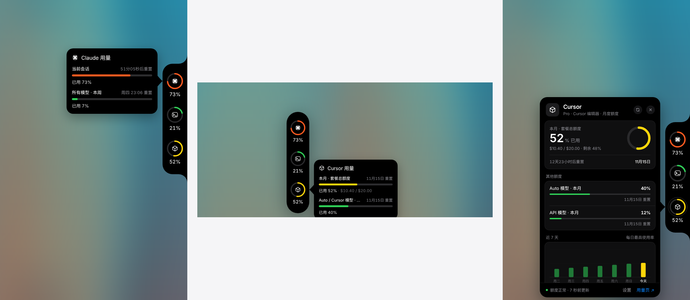

# AI 用量监控（AI Usage Monitor）

**中文** · 一个贴在屏幕边缘的桌面小组件，实时显示多个 AI 编程工具的用量：5 小时额度、每周额度、重置倒计时、套餐信息、近 7 天趋势。
AI 任务完成或需要你处理时会弹出提醒，点一下就切回对应的窗口。Apple 极简风格，纯黑竖条，支持 macOS 和 Windows。

**English** · A desktop widget that docks to the edge of your screen and shows live usage for multiple AI coding tools —
5-hour and weekly limits, reset countdowns, plan info and 7-day trends for Claude, Codex (ChatGPT), Cursor, Gemini CLI,
GitHub Copilot, Kimi and GLM. It also notifies you when an AI task finishes or needs your input, and one click brings
the right window to the front. Minimal pure-black design; runs on macOS and Windows (Electron, zero npm dependencies).
All data stays on your machine.

---

- **平台**：macOS 12+（Apple 芯片 / Intel）、Windows 10/11 x64。两端是同一套代码（Electron）。
- **支持的 AI**：Claude（Claude Code / 桌面版 / 网页版）、Codex、Cursor、Gemini CLI、GitHub Copilot、Kimi Code、智谱 GLM Coding Plan。
- **界面**：纯黑竖条吸附在屏幕左右边缘（上下用内凹弧与屏幕边缘相接），也可以拖出来自由悬浮。
  - 极简模式（默认）：悬停图标弹出黑色气泡，显示当前会话 / 所有模型两条额度。
  - 详细模式：点击图标展开完整面板。
- **更新方式**：事件驱动加智能频率。本地会话文件一有写入，就在几秒内刷新；闲置时自动放慢；偶发的网络失败会静默重试。
- **任务提醒**：Codex / Claude Code / WorkBuddy / CodeBuddy / BoxAI 的任务，以及 Claude、ChatGPT 的普通聊天（需登录网页版），完成或需要你处理时弹出提醒，图标上保留脉冲光圈；点击提醒切回任务所在的窗口。

## 下载

到 [Releases](../../releases) 下载最新版：`AI用量监控-mac-arm64-*.zip`（Apple 芯片 Mac）、`AI用量监控-win-x64-*.zip`（Windows 10/11）。
Mac 首次打开如提示「已损坏」，运行一次 `xattr -cr "/Applications/AI Usage Monitor.app"`（见 [Mac 安装说明](docs/Mac版安装说明.txt)）。



---

## 目录结构

```
ai-usage-monitor/
├── app/                      # 应用源码（Electron，零 npm 依赖）
│   ├── package.json          # 版本号在这里改
│   ├── main.js               # 主进程：悬浮层窗口、托盘、设置窗口、网页登录、IPC、代理、休眠处理
│   ├── preload.js            # 渲染进程可用的 API（window.aimon）
│   ├── core/
│   │   ├── providers.js      # ★ 各家 AI 的数据获取（接口、字段解析）
│   │   ├── engine.js         # ★ 刷新调度：事件驱动、智能频率、容错退避、休眠暂停、快照
│   │   ├── locallogs.js      # Claude Code / Codex 本地会话日志增量解析
│   │   ├── tasks.js          # 任务完成提醒：读各 AI 的本机会话记录
│   │   ├── chatwatch.js      # 对话完成提醒：Claude / ChatGPT 普通聊天（用网页登录查询最近对话）
│   │   ├── foreground.js     # 前台窗口检测、点击提醒时切到任务所在的软件
│   │   ├── secrets.js        # 读取本机登录凭据（钥匙串、Electron safeStorage 解密）
│   │   ├── store.js          # 配置、历史、快照的读写
│   │   ├── http.js           # 统一 HTTP（Chromium 网络栈，可注入假实现做测试）
│   │   └── util.js           # 工具函数
│   ├── renderer/
│   │   ├── overlay.html/css/js   # ★ 屏幕边缘竖条、气泡、详细面板
│   │   ├── settings.html/js      # 设置窗口
│   │   └── common.js             # 图标、配色、时间格式（两个窗口共用）
│   └── assets/               # 托盘图标、应用图标
├── scripts/                  # 构建与预览脚本（见 docs/BUILD.md）
├── test/                     # 测试（node 直接运行，见下）
├── docs/                     # 架构、数据源、构建、用户说明
├── legacy/wails-windows/     # 旧版 Windows 实现（Go + Wails），已被 app/ 取代，仅供参考
├── AGENTS.md                 # ★ 给 AI 助手 / 新开发者的开发指南（先读这个）
└── CHANGELOG.md
```

## 快速开始（开发）

```bash
# 方式一：有 npm 的环境
cd app && npm i -D electron@45 && npx electron .

# 方式二：无 npm（本项目的构建方式）——脚本会自动下载 Electron 官方包
./scripts/preview.sh /tmp/shot.png        # Linux + xvfb：用演示数据运行并截图

# 测试
./test/run-all.sh
```

开发时常用的环境变量：

| 变量 | 作用 |
|---|---|
| `AIMON_MOCK=1` | 使用演示数据，不联网 |
| `AIMON_DATA=/path` | 指定数据目录（默认是系统的 userData） |
| `AIMON_STYLE=detail` | 启动时使用详细模式 |
| `AIMON_DOCK='{"edge":"left","y":0.5}'` | 启动时的位置 |
| `AIMON_SHOT=a.png` / `AIMON_SHOT_SCRIPT=...` | 截图后退出，用于界面回归检查 |

## 构建发布包

```bash
./scripts/build-all.sh        # → dist/AI用量监控-mac-arm64-vX.zip、-mac-x64-vX.zip、-win-x64-vX.zip
```

详见 [docs/BUILD.md](docs/BUILD.md)，其中包括签名、公证、在 macOS 或 Linux 上构建的区别。

## 文档

- [AGENTS.md](AGENTS.md)：开发约定、踩过的坑、修改前必读
- [docs/ARCHITECTURE.md](docs/ARCHITECTURE.md)：进程模型、窗口设计、刷新引擎、数据结构、IPC
- [docs/PROVIDERS.md](docs/PROVIDERS.md)：每个 AI 的凭据来源、接口、字段、回退策略
- [docs/BUILD.md](docs/BUILD.md)：构建、签名、发布
- [docs/ROADMAP.md](docs/ROADMAP.md)：已知问题与可优化方向
- 用户说明：[Mac](docs/Mac版安装说明.txt)、[Windows](docs/Windows版使用说明.txt)

## 隐私

所有配置、登录状态、历史只保存在本机：

- macOS：`~/Library/Application Support/AI 用量监控/`
- Windows：`%APPDATA%\AI 用量监控\`

程序只请求各家 AI 自己的用量接口，不经过任何第三方服务器。

## 许可

MIT
